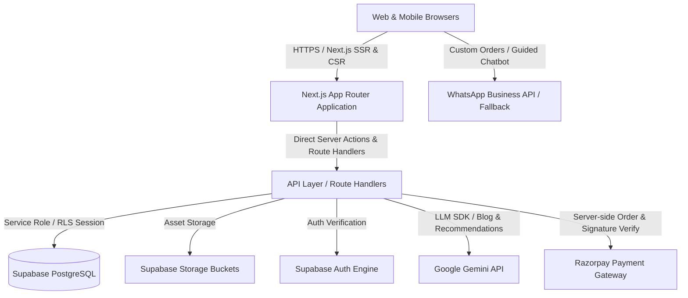

# ROOH VASTR — ARCHITECTURE & IMPLEMENTATION BLUEPRINT

## 1. Proposed Architecture

ROOH VASTR is designed as a modern, high-performance, edge-ready e-commerce platform built on **Next.js (App Router)** and **Supabase (PostgreSQL, Auth, Storage, RLS)**, deployed on **Vercel**.



### Key Architectural Tenets:
1. **Unified Modern Stack (Zero PHP)**: Next.js 15+ App Router, React 19, TypeScript (strict), Tailwind CSS, Lucide icons, Motion.
2. **Dual-Purchase Flow Engine**: 
   - **Flow A (Ready-Made)**: Instant client-to-server cart, strict server-side price & stock verification, Razorpay online checkout.
   - **Flow B (Custom / Print-on-Demand)**: WhatsApp guided intake flow, structured custom-order database record creation, manual preview upload, quotation, revision history, customer approval pipeline.
3. **Defense-in-Depth Security**:
   - Supabase Row-Level Security (RLS) on all 30+ tables.
   - Server-side price calculation (client totals never trusted).
   - Atomic inventory adjustments and coupon usage counters.
   - Strictly protected `/admin` dashboard with server-side RBAC validation.
4. **Resilient Integration Layer**:
   - Graceful degradation when external services (Razorpay, WhatsApp API, Gemini AI) are offline or missing credentials. Built-in mock/demo store state when Supabase connection string is not yet supplied.

---

## 2. Target Folder Structure

```
web/
├── app/
│   ├── (storefront)/
│   │   ├── page.tsx                       # Homepage (Configurable DB sections)
│   │   ├── layout.tsx                     # Storefront layout (Header, Nav, Footer, Exit Intent)
│   │   ├── shop/page.tsx                  # Shop All / Catalog
│   │   ├── category/[slug]/page.tsx       # Category & Subcategory listing
│   │   ├── product/[slug]/page.tsx        # Product details (Dual: Buy Now & Customize)
│   │   ├── custom-printing/page.tsx       # Dedicated Print-on-Demand services
│   │   ├── bulk-orders/page.tsx           # Corporate & Bulk ordering
│   │   ├── cart/page.tsx                  # Shopping cart
│   │   ├── checkout/page.tsx              # Secure checkout
│   │   ├── order-confirmation/[id]/page.tsx
│   │   ├── orders/track/page.tsx          # Order tracking
│   │   ├── blog/page.tsx                  # Blog listing
│   │   ├── blog/[slug]/page.tsx           # Blog article & structured data
│   │   ├── about/page.tsx                 # About Rooh Vastr
│   │   ├── contact/page.tsx               # Contact Us
│   │   └── faq/page.tsx                   # FAQ page
│   ├── (admin)/admin/
│   │   ├── layout.tsx                     # Admin shell & sidebar
│   │   ├── page.tsx                       # Dashboard analytics & alerts
│   │   ├── products/                      # Product catalog CRUD & variants
│   │   ├── categories/                    # Category management
│   │   ├── homepage-builder/              # Dynamic sections & banner management
│   │   ├── orders/                        # Ready-made orders & fulfillment
│   │   ├── custom-orders/                 # Custom POD workflow & preview upload
│   │   ├── coupons/                       # Coupons & exit-intent settings
│   │   ├── blogs/                         # AI blog generation, approval & scheduler
│   │   └── settings/                      # Brand, WhatsApp, Payments, AI config
│   ├── api/
│   │   ├── checkout/                      # Server-side pricing & order creation
│   │   ├── payments/verify/               # Razorpay signature verification
│   │   ├── custom-orders/                 # Inbound custom order intake
│   │   ├── ai/gift-finder/                # Gemini-powered catalog-grounded recommendations
│   │   ├── ai/blog-generate/              # Gemini 4x daily blog generator
│   │   └── cron/daily-blogs/              # Authenticated cron endpoint
│   ├── sitemap.ts                         # Dynamic XML sitemap
│   └── robots.ts                          # Dynamic robots.txt
├── components/
│   ├── ui/                                # Reusable UI primitives (Button, Modal, etc.)
│   ├── layout/                            # Header, AnnouncementBar, Footer, MobileNav
│   ├── storefront/                        # ProductCard, CategoryCard, HeroBanner, Reviews
│   ├── custom-printing/                   # CustomOrderModal, WhatsAppHandoff
│   ├── ai/                                # GiftFinderModal, RecommendationTray
│   └── admin/                             # AdminTable, SectionBuilder, PreviewUploader
├── lib/
│   ├── supabase/                          # Browser, Server & Service client factories
│   ├── gemini.ts                          # Google Gemini AI client & prompt helpers
│   ├── razorpay.ts                        # Payment helpers & signature verifiers
│   ├── types.ts                           # Comprehensive TypeScript domain types
│   └── utils.ts                           # Formatting, slugify, cn helper
├── supabase/
│   └── migrations/
│       ├── 01_initial_schema.sql          # 30+ normalized tables & indexes
│       ├── 02_rls_policies.sql            # Secure RLS rules
│       └── 03_seed_data.sql               # Rooh Vastr launch catalog & categories
├── .env.example
├── .env.local
└── tailwind.config.ts
```

---

## 3. Database Schema Overview (30+ Tables)

- **Auth & Profiles**: `profiles`, `user_roles`, `addresses`
- **Catalog**: `categories`, `subcategories`, `products`, `product_images`, `product_variants`, `inventory`, `tags`, `product_tag_assignments`
- **Customer Commerce**: `carts`, `cart_items`, `wishlists`, `wishlist_items`, `orders`, `order_items`, `reviews`
- **Payments**: `payments`, `payment_webhook_events`
- **Custom Print Workflow**: `custom_order_requests`, `custom_order_attachments`, `custom_order_previews`, `custom_order_revisions`
- **Marketing & Growth**: `coupons`, `coupon_redemptions`, `promotional_campaigns`, `customer_offer_assignments`, `newsletter_subscriptions`
- **CMS & Builder**: `homepage_sections`, `homepage_banners`, `site_settings`
- **AI & Content**: `blog_categories`, `blog_posts`, `blog_generation_runs`, `blog_generation_logs`
- **Auditing**: `audit_logs`

---

## 4. Environment Variables Checklist

```env
# App
NEXT_PUBLIC_SITE_URL=http://localhost:3000
NEXT_PUBLIC_APP_NAME="ROOH VASTR"

# Supabase
NEXT_PUBLIC_SUPABASE_URL=https://your-project.supabase.co
NEXT_PUBLIC_SUPABASE_ANON_KEY=your-anon-key
SUPABASE_SERVICE_ROLE_KEY=your-service-role-key

# AI Integration (Gemini)
GEMINI_API_KEY=your_gemini_api_key_here
GEMINI_MODEL=gemini-2.5-flash

# Payments (Razorpay)
NEXT_PUBLIC_RAZORPAY_KEY_ID=rzp_test_xxxxxx
RAZORPAY_KEY_SECRET=your_razorpay_secret
RAZORPAY_WEBHOOK_SECRET=your_webhook_secret

# WhatsApp
NEXT_PUBLIC_WHATSAPP_NUMBER=919876543210
WHATSAPP_API_TOKEN=your_whatsapp_token

# Automation & Cron Security
CRON_SECRET=your_secure_cron_token
```

---

## 5. Design System Tokens

- **Deep Burgundy**: `#6D1835` (Primary CTA, luxury accents, active state)
- **Warm Ivory**: `#FAF7F2` (Page canvas, soft contrast backgrounds)
- **Charcoal Black**: `#242124` (High-legibility typography, headers)
- **Muted Rose**: `#C98F9F` (Secondary accents, badges, subtle highlights)
- **Soft Beige**: `#EAE0D5` (Borders, card dividers, muted tags)
- **Pure White**: `#FFFFFF` (Surface cards, input fields)
- **Typography**: 
  - Serif Headings: *Cormorant Garamond* / *Playfair Display*
  - Sans-Serif Interface: *Plus Jakarta Sans* / *Inter*
